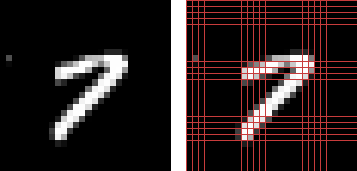

# Chapter 1: What Is an ImageNet?

## Learning Objectives

By the end of this chapter, you will be able to:

- Explain how a picture becomes a table of numbers that a program can learn from.
- Describe an image classification task in terms of inputs, labels, and accuracy.
- Say what "ImageNet" means in this book, and what it does not mean.
- Name the layers of the learning loop: predict, measure the error, adjust, repeat.
- Load an image dataset into Orange and inspect its pictures, columns, and class balance.

---

## 1.1 A Picture Is a Table of Numbers

To you, the image below is a handwritten 7. To a computer it is a grid of 28 rows by 28 columns of numbers, one per pixel. Each number says how bright that pixel is: 0 is black, 255 is white, and everything in between is a shade of gray.

Here are six rows and six columns taken from the top of that 7 (rows 8 to 13, columns 16 to 21):

| | c16 | c17 | c18 | c19 | c20 | c21 |
|---|---|---|---|---|---|---|
| **r8** | 3 | 37 | 37 | 37 | 7 | 0 |
| **r9** | 193 | 254 | 254 | 254 | 124 | 0 |
| **r10** | 125 | 201 | 254 | 254 | 246 | 0 |
| **r11** | 0 | 98 | 254 | 255 | 152 | 0 |
| **r12** | 117 | 245 | 254 | 221 | 25 | 0 |
| **r13** | 246 | 254 | 222 | 33 | 0 | 0 |

The bright numbers (about 254) are the stroke of the pen, and the 0s are the empty page around it. That is all an image is: a table. If you have used Orange before, you already know what to do with a table, because each pixel can be a feature (a column), exactly like *age* or *petal length*.

A whole 28 x 28 image has 28 x 28 = **784** pixels, so one image is one row with 784 features. A color image has three numbers per pixel (red, green, blue), so a 32 x 32 color photo has 32 x 32 x 3 = **3,072** features. The number of rows, columns, and color layers is called the image's **shape**. MNIST digits have shape 28 x 28 x 1 (one gray layer). CIFAR-10 photos have shape 32 x 32 x 3.

> 💡 Real photos are much larger than these. A phone photo has millions of pixels. Training on them is slow, which is why this book uses tiny images: you can train every network here on an ordinary laptop in seconds to minutes.

---

## 1.2 Classification: Pictures In, Labels Out

The task this book starts with is **image classification**: given a picture, say which category it belongs to.

- The **input** is the pixel table for one image.
- The **label** (also called the *class* or *target*) is the right answer, such as "7". In Orange, the label is stored in the *class* variable, which Import Images calls **category**.
- The **output** of a trained model is its best guess at the label.
- **Accuracy** is the share of images the model labels correctly. If a model gets 93 of 100 right, its accuracy is 93%.

A model learns from **training images**, whose labels it is allowed to see. We then judge it on **test images** it has never seen. A model that only does well on pictures it has already studied has memorized, not learned; Chapter 5 is about that problem.

You could feed the 784 pixels into any Orange classifier, such as logistic regression. That works reasonably well for digits (in Chapter 3 a very plain network with no image-specific tricks scores about 88%). But a pixel table throws away something important: *which pixels are next to which*. A stroke is a set of neighboring bright pixels. The networks in this book, **convolutional neural networks** (CNNs), are built to use that neighborhood structure, and Chapter 3 shows what it buys you.

---

## 1.3 What "ImageNet" Means Here

The word causes confusion, so let us settle it now.

- **ImageNet** (one word, capital I) is a famous collection of over a million labeled photos used to benchmark image classifiers. We do **not** use it.
- The **orange3-imagenets** add-on, and this book, use "**ImageNet**" in a plainer sense: *an image network*, a neural network that takes images. The add-on's widgets are named *Build ImageNet*, *Train ImageNet*, and so on.
- The Orange3-ImageAnalytics add-on also offers embedders such as *squeezenet* that were trained on the big ImageNet collection. We will meet one in Chapter 7. That is a different thing.

When this book says "an ImageNet", read "an image network you build and train yourself".

---

## 1.4 How a Network Learns: The Loop

A neural network is a long formula with many adjustable numbers called **weights**. The simplest network in this book has 54,410 of them. Training is a loop that adjusts the weights a little at a time:

1. **Predict.** Show the network some training images. It outputs a guess for each, as a probability for every class.
2. **Measure the error.** Compare each guess to the true label. The **loss** is a single number: small when the network was confidently right, large when it was wrong.
3. **Adjust.** Nudge every weight in the direction that would have made the loss smaller. The size of the nudge is the *learning rate*.
4. **Repeat.** One pass through all the training images is an **epoch**. Run several epochs.

You will watch this loop happen. *Train ImageNet* draws the loss going down and the accuracy going up, epoch by epoch. A typical first run on MNIST starts at about 78% training accuracy after epoch 1 and reaches about 96% by epoch 5. You do not need the calculus of step 3. You do need to be able to read the graph.

---

## 1.5 The Datasets You Will Meet

| Dataset | Pictures | Classes | Shape | What it is |
|---|---|---|---|---|
| **MNIST** | handwritten digits | 10 (0 to 9) | 28 x 28 x 1 | The classic "hello world" of image learning |
| **Fashion-MNIST** | clothing items | 10 (bag, boot, coat, ...) | 28 x 28 x 1 | Same size as MNIST, harder |
| **EMNIST letters** | handwritten letters | 26 (a to z, capitals and lowercase merged) | 28 x 28 x 1 | More classes, more confusable shapes |
| **CIFAR-10** | small color photos | 10 (airplane, car, bird, cat, ...) | 32 x 32 x 3 | Real photos, much harder |

The full datasets are large (CIFAR-10 alone is 170 MB to download), so the book works with small subsets you build yourself: 500 training images and 100 test images per class. Chapter 2 explains how to build them and compares them.

---

## 1.6 The Widgets

| Widget | Add-on | What it does | Key settings |
|---|---|---|---|
| *Import Images* | ImageAnalytics | Reads a folder of images; the name of each subfolder becomes the class | The folder to read |
| *Image Viewer* | ImageAnalytics | Shows the pictures as a grid of thumbnails | **Image Filename Attribute**, zoom slider |
| *Data Table* | Orange | Lists rows and columns | Nothing to set for this book |
| *Distributions* | Orange | Bar chart of how many rows have each value | **Variable** (choose *category*) |

*Import Images* makes one row per picture, with these columns: **category** (the class), and the meta columns **image name**, **image** (the path to the file, relative to the folder you chose), **size** (the file size in bytes), **width**, and **height**. Notice that the table holds the *path* to each picture, not its pixels. The networks you build later read the files themselves.

---

## Lab Exercise 1A: Look at Your Data

**Goal:** Load MNIST into Orange and learn what each row and column means.

*Time: 5 minutes. Needs only a CPU.*

**Before you start:** build the MNIST subset. In a terminal, in the book's folder, run `make datasets` (the first run downloads MNIST and takes a minute or two; CIFAR-10 and EMNIST are slower). This creates `datasets/mnist/train/0/`, `datasets/mnist/train/1/`, and so on. Each subfolder holds the PNG pictures of one digit.

**Steps:**

1. Add an *Import Images* widget. Double-click it and choose the folder `datasets/mnist/train`. Wait for the import to finish (a few seconds).
2. Add a *Data Table* and connect *Import Images* to it. Look at the columns. How many rows are there? Which column is the class?
3. Add an *Image Viewer* and connect *Import Images* to it. Set the image attribute to **image** and drag the zoom slider so you can read the digits.
4. Add *Distributions* and connect *Import Images* to it. Choose **category** as the variable.

**Questions:**

1. How many pictures are in the table, and how many classes? (You should see 5,000 images in 10 classes.)
2. What are the *width* and *height* of every image? Would you expect them to vary?
3. Open the *Distributions* chart. Is every digit equally common? Why does that matter for judging accuracy? *(Hint: if 90% of the images were 0s, a model that always says "0" would score 90%.)*
4. Find an image in the viewer that you find hard to read. Would you expect a network to get it right?

> The finished workflow is `workflows/mnist-explore.ows`. The folder path inside it is absolute, so on your machine you must re-point *Import Images* at your copy of `datasets/mnist/train`.

---

## Lab Exercise 1B: Do the Numbers Change with the Dataset?

**Goal:** See that "an image dataset" can mean very different things.

*Time: 5 minutes.*

**Steps:**

1. Reuse the workflow from 1A. Add a second *Import Images* and point it at `datasets/cifar10/train`. Connect it to its own *Image Viewer* and *Data Table*.
2. Compare the two tables: the number of rows, the class names, and the **width** and **height** columns.
3. Look at the CIFAR-10 pictures in the viewer. Pick two classes, such as *cat* and *dog*, and find a picture of each that is hard to tell apart.

**Questions:**

1. How is a CIFAR-10 image different from an MNIST image, apart from the subject? (Hint: count the color layers. The table does not show them, but the pictures do.)
2. A 32 x 32 x 3 CIFAR-10 image has how many features compared with a 28 x 28 x 1 MNIST image? (3,072 against 784.)
3. Before looking at Chapter 2, predict: will a network find CIFAR-10 easier or harder than MNIST? Write down a guess for its accuracy.

> Keep your prediction. In Chapter 2 you will check it with a real number.

---

## Comprehension Questions

1. A 64 x 64 color image is made of how many numbers? Show the multiplication.
2. What is the difference between a training image and a test image, and why do we report accuracy on the test images?
3. In Orange's image table, where is the picture itself stored, and what does the *image* column contain?
4. A dataset has 1,000 images: 950 cats and 50 dogs. A model that always answers "cat" has what accuracy? What does that tell you about reading accuracy numbers?
5. What does the loss measure, and what happens to the weights when the loss is large?
6. Does "ImageNet" in this book refer to the million-photo benchmark? Explain.

---

## Key Terms

- **Pixel**: one dot of an image; a number from 0 to 255 per color layer.
- **Shape**: rows x columns x color layers, e.g. 28 x 28 x 1.
- **Grayscale / RGB**: one layer of brightness, or three layers (red, green, blue).
- **Label / class**: the correct category for an image.
- **Classification**: choosing a label for an input.
- **Accuracy**: the share of images labeled correctly.
- **Training / test images**: pictures the model learns from, and pictures held back to judge it.
- **Weights**: the adjustable numbers inside a network.
- **Loss**: one number measuring how wrong the predictions are.
- **Epoch**: one pass through all the training images.
- **CNN**: a convolutional neural network, built to use the layout of pixels.

---

## Notes

- **Workflow for this chapter:** `workflows/mnist-explore.ows`.
- **Datasets:** `make datasets` writes `datasets/<name>/{train,test}/<class>/<n>.png`, 500 training and 100 test images per class (the folders are not stored in the repository). The exact numbers in this book come from these subsets, so your results may differ by a point or two.
- **Sources:** MNIST (LeCun, Cortes, and Burges), Fashion-MNIST (Zalando Research, MIT license), EMNIST (Cohen, Afshar, Tapson, and van Schaik, 2017), CIFAR-10 (Krizhevsky, 2009).
- **Numbers quoted:** the 54,410-weight network, the ~78% first-epoch and ~96% fifth-epoch training accuracy, and the ~88% score of the no-convolution network come from the runs in Chapter 3 (Lab 3A and Lab 3C).
