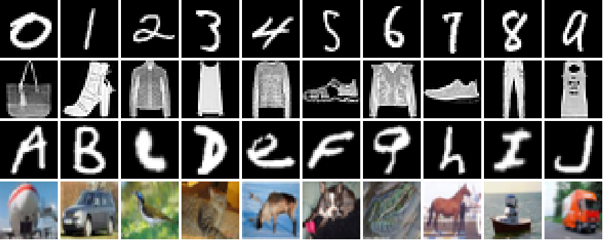

# Chapter 2: Image Data

## Learning Objectives

By the end of this chapter, you will be able to:

- Build the book's datasets and describe how MNIST, Fashion-MNIST, EMNIST letters, and CIFAR-10 differ.
- Match a network's input shape and output size to a dataset.
- Resize images with *Preprocess Images* and measure what is lost.
- Create extra training images with *Augment Images* and explain why a held-out test set must never be augmented.
- Predict which datasets will be easy or hard, then check the prediction with a measured accuracy.

---

## 2.1 Four Datasets

Chapter 1 introduced the datasets; here we look closer.



| Dataset | Classes | Shape | Why it is in this book |
|---|---|---|---|
| **MNIST** | 10 digits | 28 x 28 x 1 | The easiest case: clean, centered, high contrast |
| **Fashion-MNIST** | bag, boot, coat, dress, pullover, sandal, shirt, sneaker, trouser, tshirt | 28 x 28 x 1 | The same format as MNIST but the shapes are less distinct (shirt, tshirt, and pullover look alike) |
| **EMNIST letters** | 26 letters, a to z | 28 x 28 x 1 | Many more classes; capital and lowercase are merged, so the class "e" contains both *E* and *e* |
| **CIFAR-10** | airplane, automobile, bird, cat, deer, dog, frog, horse, ship, truck | 32 x 32 x 3 | Real color photographs: backgrounds, lighting, and poses vary |

Two things to notice in the figure. MNIST, Fashion-MNIST, and EMNIST are white on black, centered, and gray, so the only thing that varies is the shape. CIFAR-10 pictures have color, clutter, and objects of any size in any part of the image. Everything a network must learn about a cat has to survive all of that.

### Building the subsets

Each dataset is built as a folder tree that *Import Images* reads directly:

```
datasets/mnist/train/0/0000.png
datasets/mnist/train/0/0001.png
...
datasets/mnist/test/9/0099.png
```

`make datasets` runs `utils/export_datasets.py`, which downloads each dataset once and writes **500 training images and 100 test images per class**. That is 5,000 training images for the 10-class sets and 13,000 for the 26-class EMNIST letters. The folders are not stored in the repository. You can build one dataset (`python utils/export_datasets.py mnist`) or change the size (`--per-class 1000`). Larger subsets train longer and score higher.

The **test** folder holds images the network never sees during training. It is the only fair way to compare models, and every accuracy in this book that you are told to "report" is measured on it.

---

## 2.2 Matching the Network to the Data

A network is built for one input shape and one number of classes. If either is wrong, training fails or gives nonsense.

- **Input shape.** *Build ImageNet* has an **Input Images** box with **Height**, **Width**, and **Channels**. Set it to 28 x 28 with 1 channel for the MNIST-family datasets, and 32 x 32 with 3 channels for CIFAR-10. *Train ImageNet* and *Classify Images* read the shape from the model, so images are loaded, and converted to gray or color, to match.
- **Output size.** The last layer is a *Dense* layer with one unit per class and *softmax* activation. For 10 classes, 10 units. For EMNIST letters, **26**. If this number does not match the data, *Train ImageNet* stops with an error message that tells you the two numbers.

> 💡 The shape matters for the weight count. The same *SimpleCNN* has 54,410 weights on MNIST (28 x 28 x 1) but 72,906 on CIFAR-10 (32 x 32 x 3) and 140,954 on EMNIST letters (26 outputs instead of 10).

---

## 2.3 Preparing Images: *Preprocess Images*

Raw images are not always in the form a network wants. *Preprocess Images* applies three optional steps to every image and writes the results to a new folder, then passes on a table that points at the new folder. The original files are not touched.

| Step | What it does | When to use it |
|---|---|---|
| **Convert to Grayscale** | Replaces the color layers by one brightness layer | When color does not help (reading digits) and you want fewer inputs |
| **Resize Images** | Rescales each image to a new width and height | When images differ in size, or to make training faster |
| **Normalize Images** | Stretches the brightness range of each image to cover 0 to 255 | When some pictures are dim and others bright |

Resizing is the most important of the three. It is a trade between speed and detail. Smaller images mean fewer weights and faster training, but fine detail is lost. Lab 2C measures that trade on MNIST.

A few practical rules:

- Set the options **first**, then press **Select Output Folder**. Choosing the folder is what starts the processing, and changing an option afterwards does not re-run it.
- Preprocess the training and the test images the same way, each to its own output folder. A network trained on 14 x 14 images must be tested on 14 x 14 images.
- Do not normalize "to be safe". Training already scales every pixel to 0 to 1 inside the network (the first layer of every preset is a *Rescaling* layer), so normalization only matters when image brightness varies a lot.

---

## 2.4 Making More Images: *Augment Images*

A network learns better from more images, but collecting images is expensive. **Augmentation** makes new training images by changing existing ones a little: rotating, zooming, shifting brightness. A slightly rotated 7 is still a 7, so the label stays the same.

*Augment Images* offers these changes. For every input image it saves **Augmentations per Image** new pictures (each with a random combination of the ticked options) into a folder you choose, and, if **Include the original images** is ticked, copies of the originals too.

| Option | What it does | Safe for digits? |
|---|---|---|
| **Zoom** | Zooms in or out by up to 20% | Yes |
| **Rotation** | Rotates by up to 30 degrees | Yes, in moderation |
| **Horizontal Flip** | Mirrors the image | **No.** A flipped 2 or 5 is not a digit, and a flipped *b* is a *d* (this option starts unticked) |
| **Shear** | Slants the image | Yes, in moderation |
| **Brightness** | Darkens or brightens | Little effect on MNIST; useful for photos |
| **Blur**, **Gaussian Noise** | Softens or adds speckle | Makes the network robust to poor quality |

Choose augmentations that match how the real data varies. Mirror images are natural for photos of animals and wrong for handwriting.

> ⚠️ **Never augment the test set.** The test set stands in for the unseen world, so it must be left exactly as it came. Also, *Train ImageNet*'s validation split is taken **after** augmentation, so an augmented copy of a validation picture can end up in training. Judge augmentation on the held-out test images, as Lab 2D does.

---

## 2.5 The Widgets

| Widget | What it does | Key settings |
|---|---|---|
| *Import Images* | Reads a folder tree into an image table | The folder; subfolder names become **category** |
| *Image Viewer* | Shows thumbnails | The image attribute (chosen automatically) |
| *Build ImageNet* | Designs a network layer by layer | **Input Images** (Height, Width, Channels), **Prebuilt ImageNets**, last *Dense* units |
| *Train ImageNet* | Trains the network and plots loss and accuracy | **Epochs**, **Batch Size**, **Validation split (%)** |
| *Classify Images* | Labels new images with a trained network and reports the accuracy | none |
| *Misclassified Images* | Shows which classes are confused | click a cell to see the images |
| *Preprocess Images* | Grayscale, resize, normalize into a new folder | the three options; **Select Output Folder** |
| *Augment Images* | Saves randomly changed copies | **Augmentations per Image**, the options, **Select Save Folder** |
| *Data Sampling* | Takes a random part of a table | **Fixed proportion of data**, **Stratify sample** |

---

## Lab Exercise 2A: A Tour of the Datasets

**Goal:** Look at all four datasets and predict which will be hard.

*Time: 5 minutes. Needs `make datasets` to have been run.*

**Steps:**

1. Add four *Import Images* widgets, pointed at `datasets/mnist/train`, `datasets/fashion-mnist/train`, `datasets/emnist-letters/train`, and `datasets/cifar10/train`.
2. Connect each to its own *Image Viewer*. Give the widgets distinct titles (double-click a title to rename it).
3. In each viewer, find the two classes you think a network will confuse most.
4. Write down a predicted ranking from easiest to hardest, and a guess at the test accuracy of each.

**Questions:**

1. Which pairs did you pick as most confusable? (For Fashion-MNIST, *shirt* and *tshirt*; for EMNIST, *i* and *l*, or *g* and *q*; for CIFAR-10, *cat* and *dog*.)
2. EMNIST has 26 classes and the others have 10. Does having more classes make guessing harder even before you consider the pictures? (A random guess is right 1 time in 10 for MNIST but 1 in 26 for letters.)

> The finished workflow is `workflows/datasets-tour.ows`. Re-point each *Import Images* at your own `datasets/` folder.

---

## Lab Exercise 2B: One Network, Four Datasets

**Goal:** Measure how hard each dataset is with the same simple network.

*Time: about 20 seconds of training per dataset.*

**Steps:**

For each dataset in turn:

1. Add *Import Images* for the `train` folder and another for the `test` folder.
2. Add *Build ImageNet*. In **Input Images**, set **Height**, **Width**, and **Channels** to match the dataset (28 x 28 x 1 for the first three, 32 x 32 x 3 for CIFAR-10). Choose **SimpleCNN** under **Prebuilt ImageNets**. For EMNIST letters, change the last *Dense* layer's **units** to **26**.
3. Add *Train ImageNet*. Connect *Build ImageNet* to **Learner** and the train *Import Images* to **Evaluation Data**. Set **Epochs** to 5 and **Validation split (%)** to 20. Training starts as soon as both inputs have arrived.
4. Add *Classify Images*. Connect *Train ImageNet* to **Model** and the test *Import Images* to **Data**. The accuracy on the test images appears in the widget's window.
5. Add *Misclassified Images* after *Classify Images* and note the largest red cell.
6. Write the accuracy in a table, and compare it with your prediction from 2A.

**Expected results** (5 epochs, 500 training images per class; yours will differ by a point or two because the network starts from random weights):

| Dataset | Weights | Test accuracy |
|---|---|---|
| MNIST | 54,410 | about 93% |
| Fashion-MNIST | 54,410 | about 84% |
| EMNIST letters | 140,954 | about 83% |
| CIFAR-10 | 72,906 | about 50% |

**Questions:**

1. Which dataset was easiest, and which hardest? Was your 2A ranking right?
   Which two classes did *Misclassified Images* show confused most in each? (We saw *pullover* taken for *shirt* in Fashion-MNIST, and *i* taken for *l* in EMNIST letters.)
2. EMNIST letters has 26 classes, so a random guess is right only 3.8% of the time (1 in 26), against 10% for the other datasets. Which is more impressive: 83% on letters or 84% on Fashion-MNIST?
3. On CIFAR-10 the training accuracy at the end (about 60%) is well above the validation accuracy (about 47%). On MNIST the gap is much smaller. What might that mean? *(We return to this in Chapter 5.)*
4. The network for CIFAR-10 has about 18,000 more weights than for MNIST. Most of them are not in the *Conv2D* layer (which gains only 576, from seeing 3 color layers instead of 1). Where are they? *(Hint: a 32 x 32 image leaves a bigger map after the convolution and pooling than a 28 x 28 one. Work out how many numbers reach the *Dense* layer in each case: 13 x 13 x 32 against 15 x 15 x 32.)*

---

## Lab Exercise 2C: How Small Can the Images Be?

**Goal:** Resize MNIST and measure what the network loses.

*Time: 5 minutes.*

**Steps:**

1. Start from the MNIST workflow of Lab 2B (or `workflows/mnist-cnn.ows`).
2. Add *Preprocess Images* between each *Import Images* and the next widget (one for `train`, one for `test`). In each, untick **Convert to Grayscale** and **Normalize Images**, tick **Resize Images**, and set **Width** and **Height** to **14**. Then press **Select Output Folder** and choose a new empty folder (for example `datasets/mnist14/train` and `datasets/mnist14/test`).
3. In *Build ImageNet*, set **Height** and **Width** to **14** (Channels stays 1). The *SimpleCNN* now has 11,850 weights.
4. Train for 5 epochs and read the test accuracy from *Classify Images*.
5. Repeat with 7 x 7 images (1,610 weights).

**Before you run it:** each step halves the size and cuts the pixels to a quarter. What do you expect to happen to the accuracy?

**Expected results:**

| Image size | Pixels per image | Weights | Test accuracy |
|---|---|---|---|
| 28 x 28 | 784 | 54,410 | about 93% |
| 14 x 14 | 196 | 11,850 | about 91% |
| 7 x 7 | 49 | 1,610 | about 79% |

**Questions:**

1. Shrinking to 14 x 14 lost only a couple of points but made the network more than four times smaller. When is that a good trade?
2. At 7 x 7 the accuracy drops sharply. Open a 7 x 7 image in *Image Viewer*. Can you still read the digit? Is the network's score close to yours?
3. Which digit pairs would you expect to be confused first at low resolution?

---

## Lab Exercise 2D: Does Augmentation Help? (Optional)

**Goal:** Test whether rotated and zoomed copies help a network trained on very little data.

*Time: about 10 minutes. The numbers are small and noisy, so run it two or three times.*

**Steps:**

1. Import `datasets/mnist/train`. Add *Data Sampling* and connect it. Choose **Fixed proportion of data** with **10%** and tick **Stratify sample**. That is 50 training images per class (500 in all).
2. Train *SimpleCNN* on the sample for **10** epochs with **Validation split (%)** at 0. Classify the `test` folder and write down the accuracy. This is the *plain* result.
3. Add *Augment Images* after *Data Sampling*. Tick **Zoom** and **Rotation**, leave **Horizontal Flip** unticked, set **Augmentations per Image** to **2**, tick **Include the original images**, and choose a save folder. Press **Generate Augmented Images**. This gives 1,500 images.
4. Train the same network on the augmented table with the same settings, and classify the same `test` folder. This is the *augmented* result.
5. Repeat both a few times (each training starts from different random weights) and compare the averages.

**Expected results** (four runs each, a different random 50 images per class every time):

| Training set | Test accuracy per run | Average |
|---|---|---|
| 500 images, plain | 87.3%, 87.8%, 89.2%, 87.6% | 88.0% |
| 1,500 images (500 + 1,000 augmented) | 89.4%, 90.5%, 91.4%, 89.9% | 90.3% |

**Questions:**

1. Augmentation gained about two points on average, and won in all four runs. Is that large or small? Why can't you be sure from one run?
2. Why is it a mistake to augment the test images too?
3. What kinds of augmentation would you choose for photos of cats and dogs? For handwritten letters?
4. Turn **Horizontal Flip** on and retrain. Does it hurt? Which digits would you expect to suffer?

---

## Comprehension Questions

1. Why does the last *Dense* layer of the network for EMNIST letters need 26 units, and what happens if it has 10?
2. A network was trained on 14 x 14 images. Can it classify a 28 x 28 image directly? What must you do first?
3. Name one reason to shrink images before training and one cost of doing so.
4. Why is horizontal flip a good augmentation for photos of dogs and a bad one for handwritten digits?
5. In Lab 2B, CIFAR-10 scored about 50%. Is that good or bad? What accuracy would a random guess give?
6. Why must test images be preprocessed like the training images, but never augmented?

---

## Key Terms

- **Subset**: a smaller sample of a dataset, built so it trains in seconds.
- **Input shape**: the height, width, and number of color layers the network expects.
- **Preprocessing**: changes applied identically to every image (resize, grayscale, normalize).
- **Normalization**: stretching each image's brightness to cover the full range.
- **Augmentation**: making new training images by randomly changing existing ones.
- **Class balance**: whether every class has about the same number of images.
- **Held-out test set**: images kept apart and used only to measure the final accuracy.

---

## Notes

- **Workflows for this chapter:** `workflows/datasets-tour.ows` (Lab 2A) and `workflows/mnist-cnn.ows` (the starting point for Labs 2B to 2D).
- **Datasets:** built by `make datasets` (see Chapter 1). EMNIST letters downloads a 560 MB archive the first time; the 26 classes are a to z with capitals and lowercase merged. All numbers above come from the 500-per-class subsets (13,000 EMNIST training images); a different subset size changes them.
- **Variance:** each training starts from random weights, so accuracy varies by a point or two between runs, and by more for small data (Lab 2D).
- **Numbers quoted:** SimpleCNN, Adam, 5 epochs, batch size 32, 20% stratified validation, accuracy on the 1,000 (or 2,600 for EMNIST) test images. MNIST 92.7%, Fashion-MNIST 84.1%, EMNIST letters 82.9%, CIFAR-10 50.3%. Resizing: 14 x 14, 91.2%; 7 x 7, 78.5%. Augmentation (Lab 2D, 10 epochs, no validation split): plain 87.3, 87.8, 89.2, 87.6%; augmented 89.4, 90.5, 91.4, 89.9%.
- **Licenses:** Fashion-MNIST is MIT licensed; MNIST, EMNIST (NIST), and CIFAR-10 should be cited as in Chapter 1.
