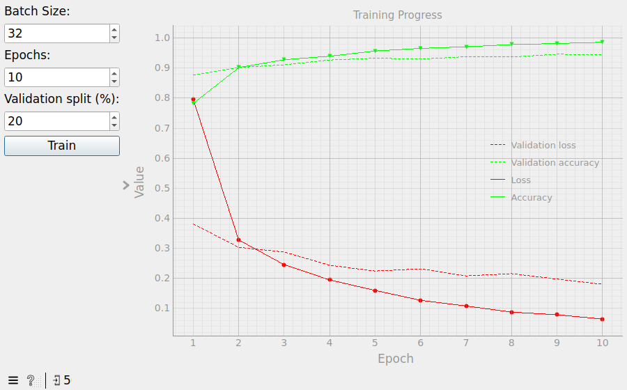
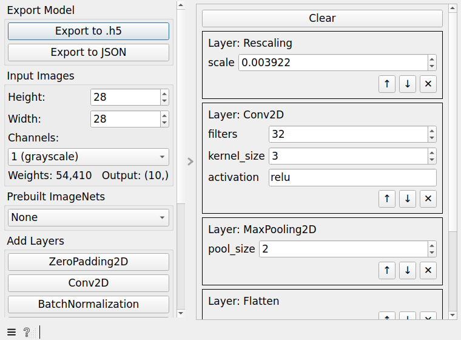
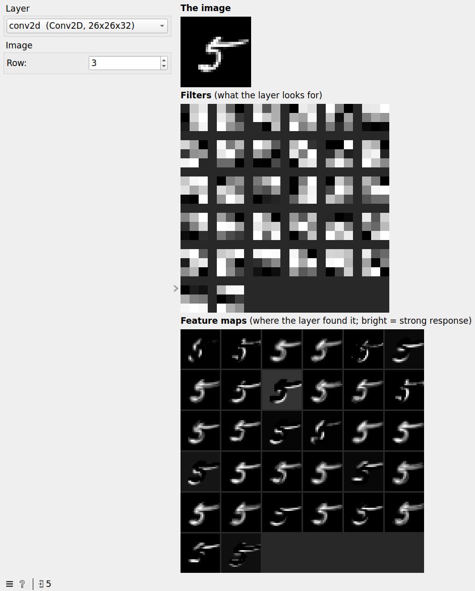

# Chapter 3: Your First CNN

## Learning Objectives

By the end of this chapter, you will be able to:

- Build a small convolutional network in *Build ImageNet* and say what each of its layers does to the shape of the data.
- Count the weights in a network layer by layer and check the total against the widget.
- Train the network on MNIST and read the loss and accuracy curves in *Train ImageNet*.
- Measure the accuracy of a trained network on test images with *Classify Images*.
- Show by experiment what the convolution layer contributes, and what changing its size does.
- Look inside a trained network at the filters it learned, and at the images it gets wrong.

---

## 3.1 The Network We Will Build

The network is called *SimpleCNN*. It has five layers, and each one changes the shape of the data in a way you can compute by hand.

| # | Layer | Output shape | Weights | What it does |
|---|---|---|---|---|
| 1 | **Rescaling** (1/255) | 28 x 28 x 1 | 0 | Turns pixel values 0 to 255 into 0 to 1 |
| 2 | **Conv2D** (32 filters, 3 x 3, relu) | 26 x 26 x 32 | 320 | Looks for 32 small patterns everywhere in the image |
| 3 | **MaxPooling2D** (2 x 2) | 13 x 13 x 32 | 0 | Keeps the strongest response in each 2 x 2 block |
| 4 | **Flatten** | 5,408 | 0 | Lays the 13 x 13 x 32 numbers out in a single row |
| 5 | **Dense** (10 units, softmax) | 10 | 54,090 | Combines everything into one score per digit |
| | **Total** | | **54,410** | |

The next four sections explain layers 2 to 5.

---

## 3.2 The Convolution Layer

A **filter** (or *kernel*) is a small grid of numbers, here 3 x 3. To apply it, you slide it over the image. At each position you multiply the 9 filter numbers by the 9 pixels underneath, add up the results, and write the sum into a new image called a **feature map**.

Here is a worked example. Take a filter that responds to a dark-to-bright vertical edge:

| Filter | | |
|---|---|---|
| -1 | 0 | 1 |
| -1 | 0 | 1 |
| -1 | 0 | 1 |

On a patch of the image that has a dark left side (0) and a bright right side (1), the sum is (0 x -1) + (1 x 1) added up over three rows: **3**, a strong response. On a flat patch (all 0, or all 1) the -1s cancel the 1s and the sum is **0**. So the feature map is bright wherever there is a vertical edge, and dark elsewhere.

The key points:

- You do **not** choose the filter numbers. They are weights, and training adjusts them until the filters detect patterns that help to tell the digits apart: edges, curves, corners.
- The *same* filter is used at every position, so a pattern is detected wherever it appears. That is why a convolution layer is so economical. Each filter has just 3 x 3 = 9 weights plus one *bias*, and 32 filters give 32 x (9 + 1) = **320** weights.
- A 3 x 3 filter cannot be centered on the outermost pixels, so a 28 x 28 image gives a 26 x 26 map. With 32 filters there are 32 maps: **26 x 26 x 32**.
- **relu** (rectified linear unit) is applied to each sum: negative values become 0 and positive values are kept. It makes the layer able to represent more than a straight line.

> 💡 For a color image, each filter has a 3 x 3 patch for each of the three color layers, so it has 3 x 3 x 3 = 27 weights, not 9.

---

## 3.3 Pooling, Flatten, and Dense

**Max pooling** shrinks each feature map. It divides the map into 2 x 2 blocks and keeps only the largest number in each block, so 26 x 26 becomes 13 x 13. The map is four times smaller, and a small shift of the digit no longer changes the result much. Pooling has no weights.

**Flatten** is bookkeeping. It takes the 13 x 13 x 32 = **5,408** numbers and writes them in one long row, because the next layer expects a row.

**Dense** (a *fully connected* layer) connects every one of the 5,408 inputs to every one of the 10 outputs. That is 5,408 x 10 = 54,080 weights, plus 10 biases: **54,090**. Most of the network's weights are in this one layer.

**Softmax** turns the 10 raw scores into 10 probabilities that add up to 1. Suppose the scores for three classes are 2.0, 1.0, and 0.1. Raise *e* to each (7.39, 2.72, 1.11), and divide by their sum (11.21): the probabilities are **0.66, 0.24, and 0.10**. The network's answer is the class with the highest probability.

---

## 3.4 Loss and Training

**Loss** says how wrong the probabilities were. For classification the loss for one image is

> **loss = -ln( p )**, where *p* is the probability the network gave to the *correct* class.

If the network gave the right answer 0.66, the loss is -ln(0.66) = 0.42. If it gave the right answer only 0.01, the loss is 4.6. If it was certain and right (p near 1), the loss is near 0. The number *Train ImageNet* plots as **Loss** is the average of this over the training images.

Each training step takes a **batch** of images (32 by default), computes the loss, and adjusts all 54,410 weights a little to reduce it. The **Adam** method decides the size of each nudge. One pass through all the images is an epoch. With 4,000 training images and a batch of 32, one epoch is 125 steps.

---

## 3.5 Reading the Training Graph

*Train ImageNet* draws a graph that updates after every epoch.

- **Loss** (red) should fall. Here it goes from about 0.8 at epoch 1 to about 0.06 at epoch 10.
- **Accuracy** (green) should rise: from about 78% to about 99%.
- The **dashed lines** are the **validation** results. When you set **Validation split (%)** to 20, the widget sets aside a random fifth of the images (the same share of every class) and does not train on them. After every epoch it scores the network on them. Validation accuracy is the honest estimate of how the network does on pictures it has not seen.

Look at the end of the graph. The training accuracy (99%) is higher than the validation accuracy (about 95%), and the dashed loss has stopped falling and begun to level off while the solid loss still drops. The network is starting to **memorize** its training images. It is the first sign of **overfitting**, the subject of Chapter 5.

---

## 3.6 The Widgets

| Widget | What it does | Key settings |
|---|---|---|
| *Import Images* | Reads the image folder | The folder |
| *Build ImageNet* | Designs the network layer by layer | **Input Images** (Height, Width, Channels), **Prebuilt ImageNets**, the **Add Layers** buttons; ↑ ↓ ✕ on each layer |
| *Train ImageNet* | Trains and plots the curves; outputs the trained model | **Batch Size**, **Epochs**, **Validation split (%)** |
| *Classify Images* | Labels new images and reports the accuracy | none |
| *Data Table* | Shows each test image with its **Prediction** | |
| *Misclassified Images* | Confusion matrix of the test results; the wrong images as output | click a cell to select those images |
| *Inspect ImageNet* | Shows the learned filters and the feature maps for one image | **Layer**, **Row** |

*Build ImageNet* shows the number of **Weights** and the **Output** shape under *Input Images*. Use it to check your hand count.

Two behaviors to know about:

- **Training starts by itself.** *Train ImageNet* trains when it has both a network and images, and again whenever either changes. Every edit to a layer in *Build ImageNet* sends a new network, which restarts training. Make your edits first, or remove the link while you edit and put it back.
- **While it trains, the Orange window pauses** (a few seconds for these labs). The progress bar shows how far along it is.

> ⚠️ *Build ImageNet* starts with the input size set to 224 x 224 x 3, which is right for photographs but not for MNIST. Change it to **28 x 28** with **1 (grayscale)** channel before you do anything else. If the number of images or the last *Dense* layer's units do not match, *Train ImageNet* tells you.

---

## Lab Exercise 3A: Build and Train Your First CNN

**Goal:** Train SimpleCNN on MNIST and measure its accuracy on test images.

*Time: about 10 seconds of training. CPU only.*

**Steps:**

1. Add *Import Images* and choose `datasets/mnist/train`. Add a second one, choose `datasets/mnist/test`, and rename it *Import Images: test*.
2. Add *Build ImageNet*. In **Input Images**, set **Height** 28, **Width** 28, **Channels** *1 (grayscale)*. In **Prebuilt ImageNets**, choose **SimpleCNN**. Check that the label says **Weights: 54,410**.
3. Add *Train ImageNet*. Set **Epochs** to **5** and **Validation split (%)** to **20**.
4. Connect *Build ImageNet* to *Train ImageNet* (**Learner**), then *Import Images* (train) to *Train ImageNet* (**Evaluation Data**). Training starts. Watch the curves appear.
5. Add *Classify Images*. Connect *Train ImageNet* to its **Model** input, and *Import Images: test* to its **Data** input.
6. Add a *Data Table* and connect *Classify Images* to it. Find a **Prediction** that disagrees with the **category**.
7. Add *Misclassified Images* and connect *Classify Images* to it. Rows are the true digits and columns the predictions; the green diagonal is correct, and every red cell is a kind of mistake. Click the reddest cell.

**Expected results:** the last epoch shows a training accuracy of about 96% and a validation accuracy of about 93% to 94%. *Classify Images* reports a test accuracy of about **93%** (it varies by a point or two from run to run, because training starts from random weights).

**Questions:**

1. Which epoch had the biggest jump in accuracy? Why do you think the first epochs improve fastest?
2. The test accuracy is a bit lower than the training accuracy. Why would you expect that?
3. Which pair of digits does the confusion matrix show confused most often? Connect the **Selected** output of *Misclassified Images* to an *Image Viewer* and look at those images. Do the mistakes look reasonable to you?

> The finished workflow is `workflows/mnist-cnn.ows`. Re-point both *Import Images* widgets at your own copy of the dataset folders.

---

## Lab Exercise 3B: More Epochs

**Goal:** See how accuracy changes with the number of epochs, and when it stops helping.

*Time: 10 to 20 seconds per run.*

**Before you run it:** you trained for 5 epochs. If you train for 10, do you expect the training accuracy to go up? The validation accuracy? Which will go up more?

**Steps:**

1. In *Train ImageNet*, set **Epochs** to **1** and press **Train**. Note the training accuracy, the validation accuracy, and the test accuracy from *Classify Images*.
2. Repeat with **5** and with **10** epochs.

**Expected results** (one run each; your numbers will differ by a point or two):

| Epochs | Training accuracy | Validation accuracy | Test accuracy |
|---|---|---|---|
| 1 | 78% | 89% | 90% |
| 5 | 96% | 94% | 93% |
| 10 | 99% | 95% | 94% |

**Questions:**

1. Why can the validation accuracy (89%) be **higher** than the training accuracy (78%) after the first epoch? *(Hint: the training accuracy is averaged over the whole epoch, while the network was still learning during it. The validation accuracy is measured once at the end.)*
2. Going from 5 to 10 epochs raised the training accuracy by 3 points and the test accuracy by only 1. What would happen with 100 epochs?
3. At what epoch would you stop training? What did you look at to decide?

---

## Lab Exercise 3C: Does the Convolution Matter?

**Goal:** Remove the convolution layer and measure what you lose.

*Time: 5 minutes.*

**Before you run it:** the network without the convolution just looks at 784 pixels as 784 unrelated numbers. Predict its accuracy.

**Steps:**

1. In *Build ImageNet*, load **SimpleCNN**, then delete the *Conv2D* and *MaxPooling2D* layers with their **✕** buttons. What is left is *Rescaling*, *Flatten*, and *Dense*. Check the label: **Weights: 7,850** (784 x 10 + 10).
2. Train 5 epochs on the same images and classify the same test images.

**Expected result:** about **89%** on the test images (this run: 88.8%), against about 93% with the convolution.

**Questions:**

1. The network with no convolution has 7,850 weights, and the one with it has 54,410. Which is more accurate? Is it the size or the structure that makes the difference?
2. This is a *linear* model, as Orange's logistic regression would be. What does the convolution add, in plain words?
3. Why does it matter for photographs that the same filter is reused at every position?

---

## Lab Exercise 3D: Change One Thing

**Goal:** Learn which settings of the convolution layer matter, by changing them one at a time.

*Time: 5 to 10 minutes.*

**Steps:** Starting from SimpleCNN, make **one** change at a time, train for **5** epochs, and record the weights and the test accuracy. Predict first: will the accuracy go up or down, and by how much?

| Change | How | Expected weights | Expected test accuracy |
|---|---|---|---|
| none (the baseline) | | 54,410 | 93% |
| fewer filters | *Conv2D* **filters** = 8 | 13,610 | 91% |
| more filters | *Conv2D* **filters** = 64 | 108,810 | 94.5% |
| bigger filters | *Conv2D* **kernel_size** = 5 | 46,922 | 95.5% |
| no pooling | delete *MaxPooling2D* | 216,650 | 94% |

**Questions:**

1. More filters helped, but each doubling cost a lot of weights. Is 64 filters worth it?
2. The 5 x 5 filter network has *fewer* weights than the baseline and scored higher. How can bigger filters have fewer total weights? *(Hint: the 5 x 5 filters make a smaller feature map, 24 x 24 instead of 26 x 26. Count the numbers that reach the *Dense* layer.)*
3. Removing pooling raised the weights fourfold and barely changed the accuracy. What does pooling buy you?
4. Run one of these twice. How much does the accuracy change between runs of the *same* network? What does that tell you about differences of a few tenths of a point?

---

## Lab Exercise 3E: Less Data (Optional)

**Goal:** See what happens when you train on fewer images.

*Time: 5 minutes.*

**Steps:**

1. Add *Data Sampling* between *Import Images* (train) and *Train ImageNet*. Choose **Fixed proportion of data**, **10%**, and tick **Stratify sample**. That is 50 images per class.
2. Train SimpleCNN for 5 epochs and classify the test images.

**Expected result:** about **84%** (this run: 83.7%), compared with about 93% for 500 images per class.

**Questions:**

1. You used a tenth of the data and lost about nine points of accuracy. What does that suggest about collecting more data?
2. In Chapter 2, augmentation made more training images from the same few. How well would it do here?

---

## Lab Exercise 3F: Look Inside

**Goal:** See the filters that training produced, and what they do to a picture.

*Time: 5 minutes.*

**Steps:**

1. In the workflow of 3A, add *Inspect ImageNet*. Connect the output of *Train ImageNet* to its **Model** input and *Import Images* (train) to its **Images** input.
2. In **Layer**, choose the *Conv2D* layer. Look at the 32 filters, and at the 32 feature maps for the image in **Row** 0. Change **Row** to look at a few other digits.

**Questions:**

1. Before training, the filters are random. What do they look like now? Do you see light and dark bands, as in the edge filter of section 3.2?
2. Compare two feature maps for the same digit. Do they respond to the same parts of the stroke?
3. Choose the *MaxPooling2D* layer. How does its map differ from the *Conv2D* map, and why is it smaller?

---

## Comprehension Questions

1. A *Conv2D* layer has 16 filters of size 3 x 3 on a 28 x 28 x 1 image. How many weights does it have, and what is its output shape? Show your count.
2. What does max pooling do to a 26 x 26 feature map, and what does it not change?
3. Why does the *Dense* layer of SimpleCNN have 54,090 weights? Show the arithmetic.
4. The softmax output for an image is 0.70, 0.20, and 0.10 for classes *a*, *b*, and *c*, and the true class is *b*. What is the loss for this image, to two decimals? *(-ln 0.2 = 1.61.)*
5. After 10 epochs the training accuracy is 99% and the validation accuracy is 95%. What does the gap tell you?
6. Why do we report the test accuracy, not the training accuracy?

---

## Key Terms

- **Convolution / filter (kernel)**: a small grid of weights slid over the image; each position gives one number of the feature map.
- **Feature map**: the image of filter responses, one per filter.
- **Activation (relu)**: the function applied after a layer; relu turns negatives to 0.
- **Max pooling**: shrinking a map by keeping the largest value in each block.
- **Flatten**: laying a stack of maps out as one row.
- **Dense layer**: every input connected to every output.
- **Softmax**: turning scores into probabilities that add up to 1.
- **Loss (cross-entropy)**: -ln of the probability given to the correct class, averaged over images.
- **Epoch, batch**: one pass through all images; the few images used for one weight update.
- **Validation split**: images held out of training and scored after every epoch.
- **Overfitting**: the network doing much better on its training images than on new ones.

---

## Notes

- **Workflow for this chapter:** `workflows/mnist-cnn.ows` (Labs 3A and 3B). Labs 3C to 3E are edits of it, and 3F uses the *Inspect ImageNet* widget that the workflow already contains (together with *Misclassified Images*).
- **Setup:** MNIST subset from `make datasets` (500 training and 100 test images per class). Labs use *SimpleCNN* with the Adam method, batch size 32, and a 20% validation split.
- **Variance:** every training starts from random weights, so the same lab varies by a point or two. For the single-run numbers in the tables, 5 epochs gave a test accuracy between 92.7% and 93.2%, and the same network trained for 10 epochs gave 94.0% and 95.1% in two runs.
- **Numbers quoted:**
  - Training: epoch 1 loss 0.82, training accuracy 77.6%, validation accuracy 88.8%; epoch 5 training 95.9%, validation 93.5%; epoch 10 training 99.2%, validation 94.9%, test 94.0%.
  - Variants (5 epochs, test accuracy): 8 filters 91.0%; 32 filters 92.7%; 64 filters 94.5%; kernel 5, 95.5%; no pooling 93.8%; no convolution 88.8%; 50 images per class 83.7%.
- **Time:** five epochs take about 3 to 6 seconds of training on a laptop CPU.
