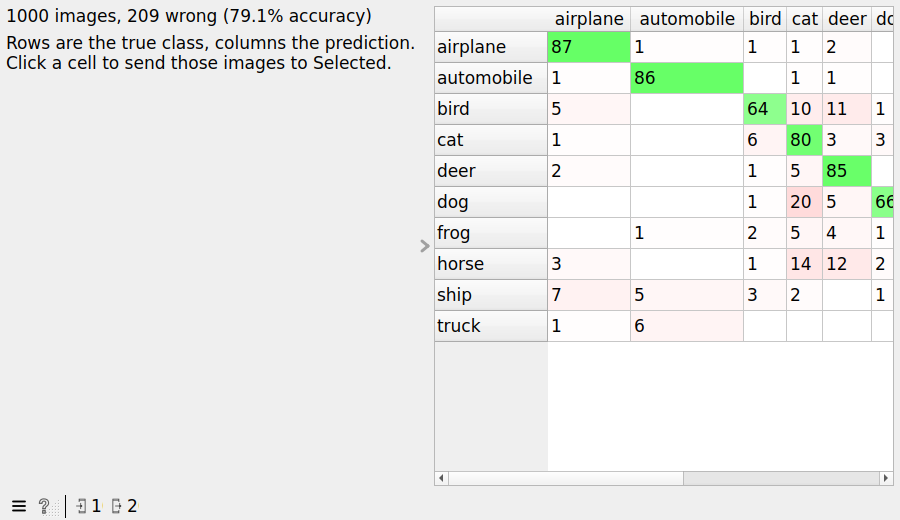

# Chapter 7: Using Models

## Learning Objectives

By the end of this chapter, you will be able to:

- Save a trained network to a file and load it again to classify new images.
- Find out where a network goes wrong, with a confusion matrix and the mistaken images themselves.
- Look at the filters a network learned and what its layers respond to.
- Start from a network that was already trained on a million photographs (transfer learning), and measure what that is worth.
- Explain why fine-tuning every weight can fail, and how the learning rate changes the result.

---

## 7.1 Saving and Loading

Training takes time, and a trained network is worth keeping. *Save ImageNet* writes the network, including all of its learned weights, to a file. *Load ImageNet* reads it back, so you can classify images tomorrow without training again.

- **Save as .h5** stores the whole model (structure and weights) in one file. This is the one to use. It works for every network in this book, including those with *BatchNormalization*, *ResidualBlock*, and a pretrained base.
- **Save as JSON** stores only the structure, with no weights. It is useful for sharing a design, and not for reusing a trained network.
- **Save GAN / diffusion model** (Chapters 8 and 9) writes a `.imagenet` file.

*Load ImageNet* offers the matching buttons and remembers the last file you loaded, so a saved workflow opens with its model already in place. Connect its output to *Classify Images* exactly as you would the output of *Train ImageNet*.

> 💡 A model expects the image size and number of color layers it was built for. A saved network that takes 28 x 28 grayscale pictures will load them correctly at that size whatever the files are like; but it must still be given the same *kind* of picture (digits on black, for a network trained on MNIST).

---

## 7.2 Where Does It Go Wrong?

A single accuracy number hides the pattern of the mistakes. *Classify Images* gives you the numbers per image; *Misclassified Images* summarizes them.

In Figure 1, 87 of 100 airplanes are right, but only 64 of 100 birds: birds are mistaken for cats, deer, and airplanes (10, 11, and 5 times). Dogs are mistaken for cats 20 times. These are the errors a human would also find hard, and each is a guide to what to fix: more bird pictures, or pictures that distinguish dogs from cats.

Click a cell, such as the true *dog* and predicted *cat* cell, and the widget sends exactly those images to its **Selected** output. Connect it to *Image Viewer* and look at them. A mistake you cannot explain is worth a closer look: sometimes the label is wrong, or the picture has no usable detail.

---

## 7.3 What Did It Learn?

*Inspect ImageNet* opens a trained network and shows two things for a chosen convolution layer.

- The **filters** are the 3 x 3 grids of weights, drawn as tiny pictures. After training they are not random: each has become a small edge or stroke detector, bright where it wants light pixels and dark where it wants dark ones.
- The **feature maps** are the layer's responses to the chosen image. Some maps light up the horizontal bar on top of the 5, others the vertical stroke, and others the outline of the whole digit. Each map is stretched to full brightness, so compare their shapes and not their brightness.

This is what Chapters 3 and 4 described in words. Choose a deeper layer from the **Layer** list and the maps get smaller and harder to read, because they respond to bigger and more abstract patterns.

---

## 7.4 Standing on Shoulders: Transfer Learning

In Chapter 6 the best network trained from scratch on 5,000 CIFAR-10 images reached about 60%. Our networks had to learn *what an edge is* and *what a texture is* from only 5,000 pictures, before they could learn what a cat is.

Someone has already taught a network to see. The ImageNet collection has 1.2 million photographs in 1,000 classes, and networks trained on it learn general-purpose features: edges, textures, parts, shapes. Those features are useful for almost any photograph, including ours. **Transfer learning** means reusing such a network:

1. Take a pretrained network and cut off its last layer, the one that chooses among its 1,000 classes.
2. Put a new last layer on, with one unit per class of **your** data.
3. Train, and let the new layer learn which of the pretrained features signify your classes.

The *Pretrained ImageNet* widget does this with **MobileNetV2**, a compact network that runs on an ordinary CPU. Its **small** size (96 x 96 pictures) has 410,208 weights in its pretrained part and only 12,810 new ones, for ten classes. If you tick **Freeze the pretrained part**, only those 12,810 weights are trained. Training is fast, and the pretrained features cannot be damaged.

The first time you use it, the widget downloads the pretrained weights (2 to 4 MB). Connect *Import Images* to it so it picks the number of classes from your data, then connect it to *Train ImageNet* as you would *Build ImageNet*.

### What does it buy?

CIFAR-10, 500 training images per class, five epochs, and the test accuracy on 1,000 pictures:

| Network | Test accuracy | Time |
|---|---|---|
| SimpleCNN from scratch (Chapter 2) | about 50% | 10 s |
| Best network from scratch (Chapter 6, BatchNorm) | 58% to 61% | 50 s (20 epochs) |
| Pretrained, small, frozen | **78.9%, 78.3%** | 23 to 33 s |
| Pretrained, medium (128 x 128), frozen | 80.6% | 48 s |
| Pretrained, small, frozen, 10 epochs | 79.5% | 40 s |
| Pretrained, small, frozen, only 50 images per class | 67.2% | 7 s |

Transfer learning turned 50%, and 60% after much design effort, into **79%** in half a minute, with a network that is hardly designed at all. And with only 50 pictures per class, a tenth of the data, it still beats a from-scratch network trained on all 500. Training for more epochs, or a larger network, adds one or two points.

It is not magic: transfer learning helps most when the task is hard and the data is small. On MNIST, where from-scratch networks do well, the frozen pretrained network reached 94.7%: better than SimpleCNN's 93%, but a smaller gain, and not as good as the 97% of the Chapter 4 two-convolution network.

### Compared with the embedding approach

*Image Embedding* in the ImageAnalytics add-on turns every picture into a row of 1,000 numbers from a pretrained network (*squeezenet*), and you then use an ordinary Orange learner. We ran *Logistic Regression* on those embeddings of the same 5,000 images: **75.8%**, a bit lower than the frozen MobileNet, and the embedding step took **9 minutes** for the 6,000 images, against half a minute for the whole of training with *Pretrained ImageNet*. The embedding route has its own advantage: it works with *any* Orange learner, and the embedding is computed once.

---

## 7.5 Fine-Tuning, and Why It Can Fail

If frozen is good, is it better to let *every* weight adapt to our data? This is **fine-tuning**. In this experiment it was worse.

| Pretrained small, all weights trained, 5 epochs | Training accuracy | Test accuracy |
|---|---|---|
| Learning rate 0.001 (the default) | 94% | **28%** |
| Learning rate 0.0001 | 96% | 66.7% |
| Learning rate 0.00001 | 59% | 44.2% |
| Frozen, learning rate 0.001 (for comparison) | 83% | **78.9%** |

At the default learning rate, the network reached 94% on its training images and 28% on the test images. The nudges to the weights were so large that they erased what the pretrained weights knew, and the network turned into a memorizer, a disaster much like the overfitting of Chapter 5. At a ten times smaller rate it did better (66.7%), and at a hundred times smaller it learned too slowly in five epochs. Fine-tuning needs a *small* learning rate, plenty of epochs, and enough data. With 5,000 images, the frozen network was better than the best fine-tuned one.

The **learning rate** is the size of each weight update (Chapter 3 mentioned it). *Train ImageNet* now has a **Learning rate** setting; for everything before this chapter, the default 0.001 was right.

---

## 7.6 The Widgets

| Widget | What it does | Key settings |
|---|---|---|
| *Save ImageNet* | Writes a trained network to a file | **Save as .h5** |
| *Load ImageNet* | Reads one back | **Load from H5** |
| *Misclassified Images* | Confusion matrix and the wrong images | click a cell for **Selected** |
| *Inspect ImageNet* | Filters and feature maps | **Layer**, **Row** (which image) |
| *Pretrained ImageNet* | A pretrained MobileNetV2 with a new last layer | **Pretrained network**, **Classes**, **Freeze the pretrained part** |
| *Train ImageNet* | Trains | **Epochs**, **Learning rate**, **Validation split (%)** |
| *Image Embedding* | Pretrained features for any Orange learner | **Embedder**: *squeezenet* (works offline) |

---

## Lab Exercise 7A: Save It and Load It

**Goal:** Keep a trained network and use it without training.

*Time: 5 minutes.*

**Steps:**

1. Open `workflows/mnist-cnn.ows` (Chapter 3) and let it train. Connect *Train ImageNet* to a *Save ImageNet*, and press **Save as .h5**. Name the file `mnist-cnn.h5`.
2. Start a new workflow: *Load ImageNet* (choose the file), *Import Images* (`datasets/mnist/test`), and *Classify Images*. Connect them. No training happens; the accuracy appears at once.

**Questions:**

1. Compare the accuracy with the one before saving. Is it exactly the same? Why?
2. What would happen if you loaded this model and classified CIFAR-10 pictures?
3. Why does the JSON file not let you do this?

---

## Lab Exercise 7B: Transfer Learning on CIFAR-10

**Goal:** Reproduce the 79% and look at the mistakes.

*Time: about 1 minute, plus the weights download the first time.*

**Steps:**

1. Open `workflows/cifar-transfer.ows`, or build it: *Import Images* (`datasets/cifar10/train`), *Pretrained ImageNet*, *Train ImageNet*, a second *Import Images* (`.../test`), *Classify Images*, and *Misclassified Images*. Connect *Import Images* (train) to both *Pretrained ImageNet* and *Train ImageNet*.
2. In *Pretrained ImageNet*, keep **small** and tick **Freeze the pretrained part**. Check that it says about 423,018 weights and 12,810 will be trained.
3. In *Train ImageNet*, set **Epochs** 5 and **Validation split (%)** 20. Training begins.
4. Read the accuracy in *Classify Images*. Open *Misclassified Images*.

**Before you run it:** you saw about 50% from scratch. What do you expect now?

**Expected results:** about **78% to 79%**, in about 30 seconds.

**Questions:**

1. Which pair of classes is confused most often? Click that cell and view the images. Do you see why?
2. Which classes are the easiest? Why would a network trained on photographs of everyday objects find these easy?
3. The training accuracy (83%) is only slightly above the validation accuracy (77%). Compare this with Chapter 6, where the gap was 40 points. Why is overfitting so much smaller here?

---

## Lab Exercise 7C: Frozen or Fine-Tuned?

**Goal:** See why a fine-tuned network needs care. (Optional: a few minutes per run.)

*Time: 2 minutes per run.*

**Steps:**

1. In the workflow of 7B, untick **Freeze the pretrained part**. Check that the number of weights to train jumps to several hundred thousand.
2. Train for 5 epochs at the default **Learning rate** (0.001). Record the training and test accuracy.
3. Set **Learning rate** to **0.0001** and train again.

**Expected results:** about 28% at 0.001 and about 65% at 0.0001, with training accuracy above 90%, against 79% for the frozen network.

**Questions:**

1. How can the training accuracy be 94% when the test accuracy is 28%? What is the network doing?
2. Why does a smaller learning rate help? What does it cost? *(Try 0.00001.)*
3. When would you expect fine-tuning to be worth the trouble? *(Think about the amount of data, and how different your pictures are from ImageNet's.)*

---

## Lab Exercise 7D: Less Data

**Goal:** Measure how little data transfer learning needs.

*Time: about 2 minutes.*

**Steps:**

1. In the workflow of 7B, add *Data Sampling* between the train *Import Images* and the other two widgets. Choose **Fixed proportion of data**, **10%**, and **Stratify sample**. That is 50 images per class.
2. Train with **Freeze the pretrained part** ticked, 5 epochs.

**Expected result:** about **67%** (this run: 67.2%), in seven seconds.

**Questions:**

1. How does 67% on 500 pictures compare with the 50% of the scratch network on 5,000?
2. If you had to label new images by hand, how many would you label before training? How would you decide when to stop?

---

## Lab Exercise 7E: The Embedding Baseline (Optional)

**Goal:** Compare transfer learning inside a network with Orange's usual learners.

*Time: about 10 minutes, mostly waiting for the embedding. This lab needs no internet, because squeezenet runs offline.*

**Steps:**

1. *Import Images* (`datasets/cifar10/train`) into *Image Embedding*, with the **squeezenet** embedder. Wait for it to finish.
2. Connect it to *Logistic Regression* and *Test and Score* (or compute the model and use it on the test images, which you embed in the same way).

**Expected result:** about **76%** on the test images (this run: 75.8%).

**Questions:**

1. Why is this method slower than *Pretrained ImageNet*, and what are its advantages?
2. Which would you choose to explore many different Orange learners on the same data?

---

## Comprehension Questions

1. What does a saved `.h5` file contain that a JSON file does not?
2. In the confusion matrix, what does a number in the row *dog* and column *cat* mean?
3. What are the "filters" that Inspect ImageNet shows, and why do they look like strokes and edges?
4. Why is transfer learning so much faster than training from scratch? Why does it need less data?
5. What does it mean to freeze part of a network, and what does it prevent?
6. A student fine-tunes a pretrained network and gets 99% training accuracy and 30% test accuracy. Give two possible remedies.

---

## Key Terms

- **Pretrained network**: a network already trained on a large collection of images.
- **Transfer learning**: reusing a pretrained network for a new task.
- **Frozen layers**: layers whose weights are not changed in training.
- **Fine-tuning**: continuing to train the pretrained weights on your data.
- **Learning rate**: the size of each weight update.
- **Embedding**: a row of numbers that describes an image, taken from a pretrained network.
- **Confusion matrix**: a table of true class against predicted class.
- **.h5 file**: a file holding a whole network, structure and weights.

---

## Notes

- **Workflows for this chapter:** `workflows/cifar-transfer.ows` (Labs 7B to 7D); Lab 7A uses `workflows/mnist-cnn.ows`.
- **Setup:** CIFAR-10 subset (500 training images and 100 test images per class). Pretrained MobileNetV2 (*small*: width 0.35 at 96 x 96, *medium*: width 0.5 at 128 x 128), weights from the ImageNet collection, downloaded by Keras on first use. Adam; 20% stratified validation; accuracy on the 1,000 test images.
- **Numbers quoted:**
  - Frozen small, 5 epochs: 78.9% (33 s) and 78.3% (23 s) in two script runs; 77.2% and 79.1% in two runs of the widgets. 10 epochs: 79.5%. Medium: 80.6%. 50 images per class: 67.2%. MNIST: 94.7%.
  - Fine-tuned small, 5 epochs: learning rate 0.001, 28.0% (training 94.1%); 0.0001, 66.7% (training 95.8%); 0.00001, 44.2% (training 59.3%).
  - Squeezenet embeddings with *Logistic Regression*: 75.8%, embedding time 555 s for 6,000 images.
- **Downloads:** the first use of *Pretrained ImageNet* needs internet access for about 2 to 4 MB. After that it works offline.
- **Variance:** a point or two between runs of the same lab; the single runs in the fine-tuning table are indicative only.
