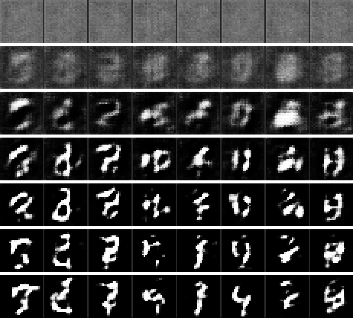
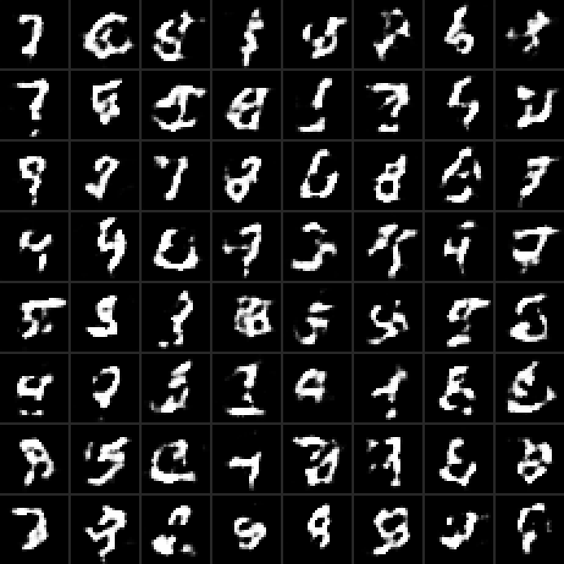
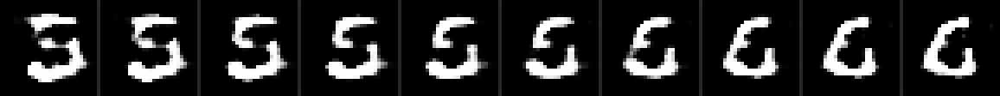
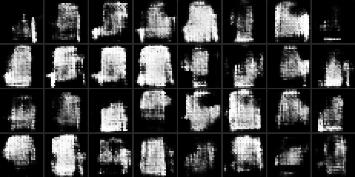
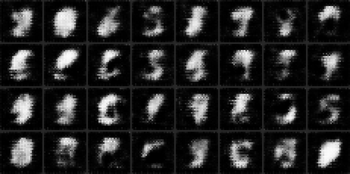

# Chapter 8: Generative Adversarial Networks

## Learning Objectives

By the end of this chapter, you will be able to:

- Explain how two networks, a generator and a discriminator, learn by competing.
- Train a small GAN on MNIST in Orange and watch the generated digits improve epoch by epoch.
- Read the discriminator's accuracy as a sign of whether the competition is balanced.
- Generate new images, and move smoothly between two of them by changing the random input.
- Say what goes wrong in GANs (rough images, limited variety) and what the evidence for it looks like.

---

## 8.1 From Recognizing Images to Making Them

Everything so far has been **discriminative**: an image goes in and a label comes out. A **generative** model does the opposite. It learns what images of some kind look like, and then produces new ones that were never in the training data. This chapter and the next present two ways to do that.

The idea of this chapter, from 2014, is to learn by competition. Imagine a forger and an art inspector.

- The **forger** (the **generator**) makes paintings. At first they are scribbles.
- The **inspector** (the **discriminator**) is shown a mixture of real paintings and the forger's, and must say which are fake.
- Each time the inspector catches a fake, the forger learns what gave it away and improves. Each time a fake passes, the inspector learns what it missed.
- The two get better together. In the end the forger's paintings are so close to real ones that the inspector can only guess.

Together the two networks are a **GAN**, a generative adversarial network. Neither is told what a digit looks like. The generator never even sees the training images: it only learns from the inspector's verdicts.

---

## 8.2 The Two Networks

Both are small CNNs of the kind you built in Chapters 3 to 6, with one of them running in reverse.

**The generator** takes a vector of **64 random numbers** (the **latent vector**, or noise) and builds a 28 x 28 image from it:

| Layer | Output shape |
|---|---|
| Random noise | 64 |
| Dense, LeakyReLU | 3,136 |
| Reshape | 7 x 7 x 64 |
| Conv2DTranspose, BatchNorm, LeakyReLU | 14 x 14 x 32 |
| Conv2DTranspose, tanh | 28 x 28 x 1 |

*Conv2DTranspose* does the opposite of a pooled convolution: it makes a map **larger**, by spreading each number over a neighborhood (7 x 7 to 14 x 14 to 28 x 28). The generator has 237,281 weights. Every different random vector gives a different image, which is how one generator produces endless pictures.

**The discriminator** is an ordinary classifier of the kind in Chapter 3:

| Layer | Output shape |
|---|---|
| Image | 28 x 28 x 1 |
| Conv2D, LeakyReLU, Dropout | 14 x 14 x 32 |
| Conv2D, LeakyReLU, Dropout | 7 x 7 x 64 |
| Flatten | 3,136 |
| Dense (1 unit) | one probability: "real" |

It has 36,513 weights. It is the smaller of the two on purpose: if the inspector gets too good too soon, the forger has nothing to learn from.

> 💡 **LeakyReLU** is relu that lets a small fraction (0.2) of negative values through instead of zeroing them. It keeps the training signal flowing in a network that must learn from a rival's mistakes.

---

## 8.3 One Training Step

Each step uses a batch of 64 real images, and does two things in turn.

1. **Train the discriminator.** Show it the 64 real images (the right answer is "real") and 64 freshly generated ones (the right answer is "fake"). Update **only the discriminator's** weights.
2. **Train the generator.** Generate 64 images, and show them to the discriminator. The generator's goal is for it to answer "real". Update **only the generator's** weights, the discriminator is held fixed.

The loss for each is the cross-entropy you met in Chapter 3, **-ln( p )**, with a different "right" answer.

| The discriminator says | Its loss | The generator's loss |
|---|---|---|
| a fake is 10% likely to be real (it caught it) | -ln(0.9) = 0.11 | -ln(0.1) = **2.30** (a big loss: it was caught) |
| a fake is 50% likely to be real (it is guessing) | -ln(0.5) = 0.69 | -ln(0.5) = 0.69 |
| a fake is 90% likely to be real (it was fooled) | -ln(0.1) = 2.30 | -ln(0.9) = **0.11** (a small loss: it fooled it) |

So the generator wants the discriminator confused, and at the end of a successful training the discriminator is right only about as often as a coin flip. One detail of the book's implementation: the discriminator is told that real images are "0.9 real" instead of "1.0 real" (**label smoothing**), which stops it from becoming overconfident and starving the generator of feedback.

---

## 8.4 Watching It Learn

We trained the GAN on 5,000 MNIST digits (500 per class), with the widget's defaults: batch size 64, learning rate 0.0002, and 30 epochs. It took 57 seconds on a laptop CPU. Every row below shows the **same eight random vectors**, at a different point in training:

- **Epoch 1.** Gray noise. The generator has learned nothing but the average brightness.
- **Epochs 2 and 3.** A bright smudge in the middle, where digits live, and then the first strokes.
- **Epochs 5 and 10.** Strokes with something like digit shapes: a loop, a bar. They are still broken and speckled.
- **Epochs 20 and 30.** Recognizable digit-like forms: what could be a 7, a 2, a 9. Most would not pass for human handwriting.

The same eight inputs keep their identity: column 1 stays "a big shape with a bar on the left", column 2 "a loop". The input vector decides *which* image, and training decides *how good* it is.

Honest assessment: after one minute of training this is not an artist. Many of the images are blobs and some look like nothing. But there are 4s, 5s, 6s, 7s, and 9s, and a **variety** of them, and a network that has never seen a digit's label produced them from noise. GANs improve a lot with more training, more data, and bigger networks. This one is limited by the time we can wait on a CPU.

### The balance

The discriminator's accuracy (on its mixture of real and fake) tells you whether the competition is balanced:

| Epoch | 1 | 2 | 3 | 5 | 10 | 20 | 30 |
|---|---|---|---|---|---|---|---|
| Discriminator accuracy | 0.90 | 0.84 | 0.88 | 0.73 | 0.59 | 0.61 | 0.66 |
| Discriminator loss | 0.49 | 0.54 | 0.48 | 0.56 | 0.66 | 0.65 | 0.63 |
| Generator loss | 0.91 | 1.02 | 1.21 | 1.12 | 0.92 | 0.91 | 0.95 |

At the beginning the discriminator is almost always right (90%), because the fakes are noise. It declines to about 60% as the generator catches up, and stays there. An accuracy of 50% would mean that it cannot tell at all (a discriminator loss of -ln 0.5 = 0.69, so 0.63 to 0.66 is near it). If the accuracy goes to 100%, the discriminator has won and the generator learns nothing; if it falls to 0%, the generator has found a trick that fools a weak inspector. Both are failures.

---

## 8.5 Moving Through the Latent Space

The 64 random numbers are a kind of address. Nearby addresses give similar images, and moving from one address to another changes the image gradually. Figure 3 takes two random vectors, and shows the generator's output for ten steps on the straight line between them:

The 5 turns smoothly into a 6: the top bar shortens, the loop closes. The generator did not memorize 5,000 pictures; it learned a continuous space of digit shapes, and every point in it makes a picture. This is why GANs are useful for design, for filling in missing pieces, and for making unlimited training images.

---

## 8.6 What Goes Wrong

GANs are famous for being hard to train. You can see two typical problems in our own results.

**Limited variety (mode collapse).** The same GAN setup, trained on Fashion-MNIST for 20 epochs (40 seconds), produced this:

All of the images are boxy tops or coats, none is a shoe, a bag, or a pair of trousers, although half of the training images were. The generator found a family of images that fool the discriminator and stayed with it. This is **mode collapse**. It is why a GAN's quality can't be judged from one picture: look at many samples and ask whether they cover the variety of the data. (A GAN that is told which class to draw would avoid this; the diffusion model in Chapter 9 does exactly that.)

**Too small a network.** A generator with only 8 filters, one-quarter as many as the default, trained for 10 epochs produces:

There is not enough capacity to draw a stroke.

---

## 8.7 The Widgets

| Widget | What it does | Key settings |
|---|---|---|
| *Import Images* | Reads the real images | The folder, for example `datasets/mnist/train` |
| *Train GAN* | Trains the generator and the discriminator, and shows samples after every epoch | **Height**, **Width**, **Channels**; **Epochs** (15), **Batch size** (64), **Noise size** (64), **Filters** (32), **Learning rate** |
| *Generate Images* | Draws new images from a trained generator | **Images**, **Random seed**; the image table it outputs can go to *Image Viewer* |
| *Image Viewer* | Shows the images | |
| *Save ImageNet* | **Save GAN / diffusion model** writes a `.imagenet` file | |

Training starts when you press **Train**. Samples from the same fixed noise appear after every epoch, as in Figure 1, and you can stop at any time. Like the networks in the earlier chapters, the GAN trains in the main program, so the Orange window pauses between epochs.

> ⚠️ Because it begins from random weights, no two training runs give the same images, and a GAN can be fine in one run and a failure in the next. That is normal for GANs.

---

## Lab Exercise 8A: Train a GAN on Digits

**Goal:** Watch a generator learn from noise.

*Time: about 1 minute for 30 epochs.*

**Steps:**

1. Open `workflows/mnist-gan.ows` (Import Images, Image Viewer, Train GAN, Generate Images, Image Viewer). Check that *Import Images* points to `datasets/mnist/train`.
2. Open *Train GAN*. Set **Epochs** to **30**, and press **Train**.
3. Watch the sample grid after epochs 1, 3, 5, 10, 20, and 30. Note what changes.
4. When it has finished, open *Generate Images* and set **Images** to 64. Look at the result in the second *Image Viewer*.

**Before you run it:** at which epoch do you think you will first see something that looks like a digit?

**Expected results:** as in Figure 1. Noise at epoch 1, strokes by epoch 5, digit-like shapes by epoch 20 to 30. Training takes about a minute.

**Questions:**

1. Compare the 64 generated images with real ones in the first *Image Viewer*. What does the generator get right? What does it get wrong?
2. How many distinct digits can you find? Does one digit appear much more than the others?
3. Do you think the generator has seen the training images? Explain.

---

## Lab Exercise 8B: Is the Competition Balanced?

**Goal:** Use the discriminator's accuracy to judge how training is going.

*Time: 5 minutes.*

**Steps:**

1. In *Train GAN*, read the **Discriminator accuracy** curve and the two loss curves in the plot as it trains. Write down the accuracy at epochs 1, 5, 10, and 30.
2. Train again with **Learning rate** 0.001 (the highest). Compare the sample grid and the discriminator accuracy.

**Before you run it:** what do you expect from a ten times larger learning rate?

**Questions:**

1. Does the discriminator accuracy decrease toward 50%, as in section 8.4? What would you conclude if it stayed at 99%?
2. With the high learning rate, were the images better or worse? What does that suggest about its balance?

---

## Lab Exercise 8C: Walking Through the Latent Space

**Goal:** See that the generator produces a smooth space of images.

*Time: 5 minutes.*

**Steps:**

1. In *Generate Images*, set **Random seed** to 1 and **Images** to 16. Note two images that you like.
2. Change the **Random seed** to 2, 3, and 4. How do the images change? Is the same seed always the same set of images?
3. The *Generate Images* widget uses the same seed to produce the same pictures. Compare a generator that has been trained for 5 epochs with one trained for 30, for the **same random seed**. (Save the first one with *Save ImageNet*, **Save GAN / diffusion model**, and load it back later with *Load ImageNet*.)

**Questions:**

1. What stays the same between the 5-epoch and 30-epoch images for the same seed, and what changes?
2. Is every picture a copy of a training digit? How could you check? *(Hint: find the most similar training image by eye.)*

---

## Lab Exercise 8D: Less Capacity, Other Data (Optional)

**Goal:** See how mode collapse and a too small network look.

*Time: 5 minutes.*

**Steps:**

1. Train with **Filters** 8 and 10 epochs on MNIST. Compare with Figure 5.
2. Point *Import Images* at `datasets/fashion-mnist/train`, set **Filters** back to 32, and train 20 epochs. Look at 32 generated images.

**Expected results:** blobs for 8 filters, and clothing-shaped but not very varied images for Fashion-MNIST (Figures 4 and 5).

**Questions:**

1. What is the most common kind of image in your Fashion-MNIST samples? Which kinds are missing?
2. How could you make the GAN draw every kind? *(See Chapter 9.)*

---

## Comprehension Questions

1. In your own words: what does the generator try to do, and what does the discriminator try to do?
2. During the generator's training step, why are the discriminator's weights left unchanged?
3. The discriminator says a generated image is 20% likely to be real. What is the generator's loss, and what is the discriminator's? *(-ln 0.2 = 1.61, -ln 0.8 = 0.22.)*
4. Why is a discriminator accuracy of about 60% a good sign, and 99% a bad one?
5. What does Figure 3 show about what the generator learned?
6. What is mode collapse? How could you detect it in the output of a GAN?

---

## Key Terms

- **Generative model**: a model that produces new data resembling its training data.
- **GAN**: two networks trained in competition.
- **Generator**: the network that makes images from random numbers.
- **Discriminator**: the network that tells real images from generated ones.
- **Latent vector (noise)**: the random numbers fed to the generator; the "address" of an image.
- **Conv2DTranspose**: a layer that makes a map larger.
- **Label smoothing**: training with 0.9 in place of 1.0 as the "real" answer.
- **Mode collapse**: a generator that makes only a few kinds of images.

---

## Notes

- **Workflow for this chapter:** `workflows/mnist-gan.ows`.
- **Setup:** MNIST or Fashion-MNIST subsets (500 images per class, 5,000 in all), 28 x 28 x 1; defaults of *Train GAN* except for the number of epochs; Adam with learning rate 0.0002 and beta 0.5 for both networks; 64 random numbers as the latent vector.
- **Numbers quoted:** MNIST, 30 epochs, 57 s, weights of the generator and discriminator 237,281 and 36,513; discriminator accuracy at epochs 1, 2, 3, 5, 10, 20, and 30: 0.90, 0.84, 0.88, 0.73, 0.59, 0.61, 0.66. Fashion-MNIST: 20 epochs, 40 s, discriminator accuracy 0.76. Small generator (8 filters): 10 epochs, 9 s, discriminator accuracy 0.79.
- **Variance:** a different random start gives different images, and the quality of a GAN varies between runs. The figures are from one run each (seed 0).
- **Caveat:** this is a deliberately small GAN. Full-size GANs trained on large datasets for days produce photographs that fool people.
