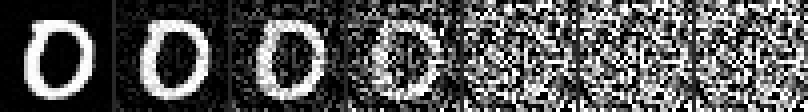
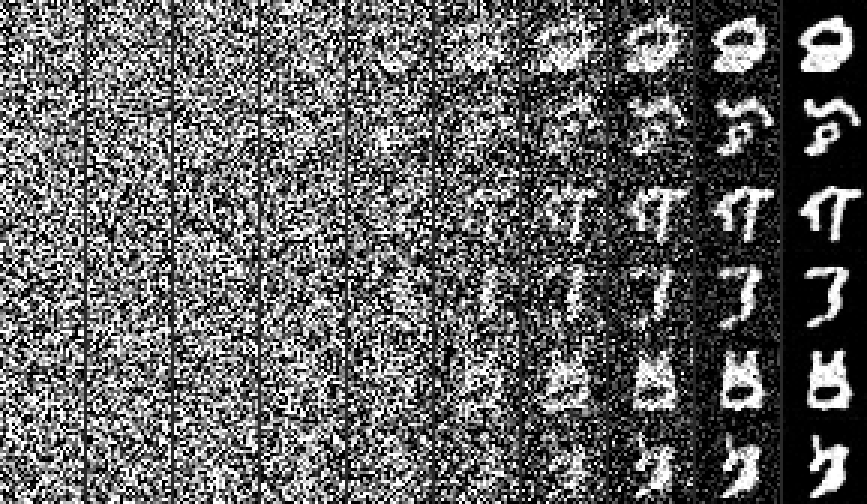
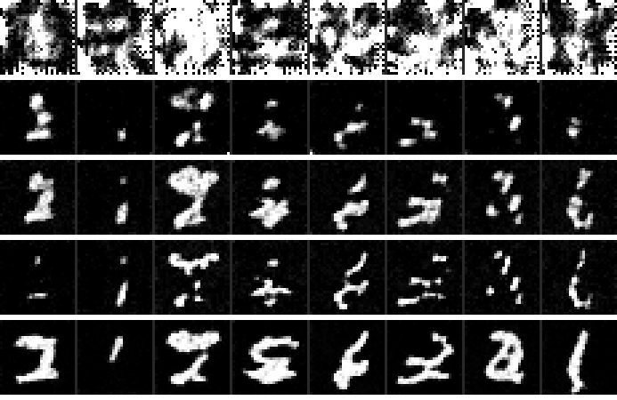
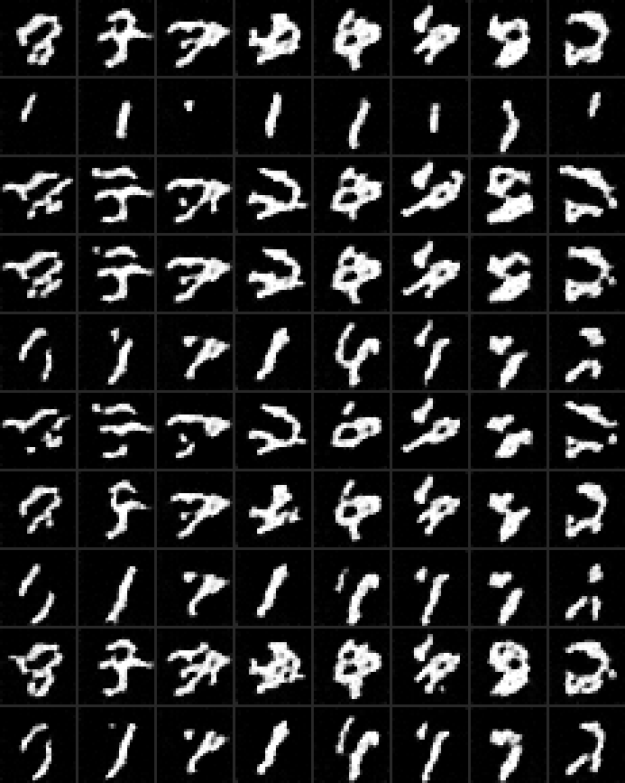
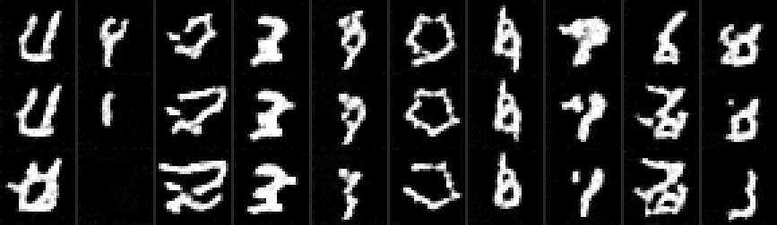

# Chapter 9: Diffusion Models

## Learning Objectives

By the end of this chapter, you will be able to:

- Explain how a diffusion model turns an image into noise step by step, and why that makes learning easy.
- Describe what the network is trained to predict, and how generating an image reverses the process.
- Train a small class-conditioned diffusion model in Orange and watch an image emerge from noise.
- Say what *guidance* does, and measure how well a conditioned model draws the class it was asked for.
- Compare diffusion with a GAN, and explain how this miniature relates to Stable Diffusion.

---

## 9.1 Destroy, Then Learn to Repair

The GAN of Chapter 8 learns by competition and is famously unstable. Diffusion models, the technology behind Stable Diffusion, DALL-E, and Midjourney, learn in a much calmer way.

Take a photograph. Add a little random noise (the speckle of a badly lit photo). Add a little more, and again, a hundred times, until nothing is left but static. That is easy, and it needs no learning at all. Now run the movie **backwards**: from static, remove a little noise at a time, and a picture appears.

A diffusion model is a network trained to do **one small step of that removal**. It is shown a noisy image and asked: *what noise was added?* If it can answer, you can subtract that noise, and then repeat. To generate a new image, you start from pure random noise and repeat the removal until an image is left.

---

## 9.2 The Forward Process: Adding Noise

The training images are noised using a recipe of **T** steps (the *Noise steps* setting: 200 here). At step *t*, the noisy image is a mix of the original image and random noise:

> **x_t = sqrt( ab_t ) x original + sqrt( 1 - ab_t ) x noise**

where **ab_t** ("alpha bar") is a number that falls from 1 to 0 as *t* goes from 0 to T. When ab is near 1 the image is almost untouched; when it is near 0 only noise is left. For our 200-step schedule:

| Step t | 0 | 10 | 25 | 50 | 100 | 150 | 199 |
|---|---|---|---|---|---|---|---|
| ab_t | 0.9995 | 0.9675 | 0.8384 | 0.5123 | 0.0728 | 0.0028 | 0.0000 |
| Share of the original image | 1.00 | 0.98 | 0.92 | 0.72 | 0.27 | 0.05 | 0.00 |
| Share of noise | 0.02 | 0.18 | 0.40 | 0.70 | 0.96 | 1.00 | 1.00 |

(The shares are the square roots, the numbers in the formula.) At step 50, for example, a pixel is 0.72 of the original plus 0.70 of noise, roughly half and half. Here is one digit at those steps:

Notice that you can jump directly to *any* step with this one formula. It is not necessary to add noise 100 times to see the image at step 100.

---

## 9.3 What the Network Learns

For each training step, the program:

1. picks a real image, and a random step *t* from 0 to 199,
2. makes a random noise image and builds the noisy image *x_t* with the formula,
3. gives the network the noisy image and *t*, and asks it to **predict the noise that was added**,
4. measures the error between the predicted and the true noise, as **mean squared error**, and adjusts the weights.

That is the entire training. There is no competitor and no label; the "answer" is the noise we put in ourselves. Because the network is told the step *t* (as a sinusoidal **time embedding**, a pattern of numbers that varies smoothly with *t*), it knows how noisy the image is and what kind of cleaning to do: removing the fine speckle at step 10, and deciding what the whole picture should be at step 150.

The network is a small **U-Net**: it shrinks the image with convolutions and pooling to see the global layout, then expands it again with upsampling to restore the detail, with shortcuts between the two halves (like the skip connections of Chapter 6). With 16 filters, for ten classes, it has 164,865 weights. Stable Diffusion's U-Net has about 860 million.

### Telling the network the class

To *choose* what to draw, the network is also given the **class** of the image (a digit 0 to 9, here), as a learned embedding that is added in, just as the time is. The class plays the role of the *prompt* in Stable Diffusion. In 10% of the training steps the class is **hidden** (replaced by a "no class" value), so the one network learns both to draw a given class and to draw "anything".

---

## 9.4 Generating: Running It Backwards

To generate an image:

1. Start from an image of pure random noise.
2. For *t* = 199 down to 0: ask the network to predict the noise in the current image, subtract the part of it that belongs to this step, and (except at the very end) add back a small amount of fresh noise.
3. The image left at the end is the result.

Every one of the 200 steps is a pass through the network, so **generating is far slower than classifying**: 100 images took about 15 seconds as one batch (or 30 seconds with guidance, which needs two passes per step). Here are the intermediate images for six digits, ten snapshots from the first noise (left) to the finished image (right):

Nothing seems to happen for the first half of the process, and the large shapes then appear within a few steps, and the rest is the refining of the edges. In the same way a sculptor can only refine a shape after the block has a shape.

---

## 9.5 Guidance

If the model has learned to draw both "a 7" and "anything", you can **exaggerate the difference**. At each step the network is run twice, with the class (*cond*) and without (*uncond*), and the noise estimate that is used is

> **estimate = ( 1 + w ) x cond - w x uncond**

where *w* is the **guidance**. With *w* = 0 you get the plain class-conditioned estimate. A larger *w* pushes the image further in the direction in which "a 7" differs from "anything": more recognizably a 7, but with less variety, and past a point, distorted. This **classifier-free guidance** is the same trick that Stable Diffusion's *guidance scale* slider controls.

---

## 9.6 What We Got

We trained the model on 5,000 MNIST digits for 30 epochs, with the defaults of *Train Diffusion* (200 noise steps, 16 filters, class conditioning). It took 385 seconds (6.4 minutes) on a laptop CPU, about 9 to 12 seconds per epoch.

| Epoch | 1 | 2 | 5 | 10 | 20 | 30 |
|---|---|---|---|---|---|---|
| Loss (mean squared error of the noise) | 0.400 | 0.122 | 0.072 | 0.054 | 0.044 | 0.040 |

The loss falls fast at first, and then slowly. Remember that the loss of "predict zero noise" would be 1.0.

After epoch 1 the images are noise. By epoch 5 they are blobs in the middle of the picture, by epochs 10 and 20 they are strokes, and after epoch 30 many are connected shapes, and a "1" (the second column) is a clean vertical stroke.

**We must be honest: this is a poor generator.** Look at Figure 4, which asks for ten images of each class (rows 0 to 9, from top to bottom), all from the same random inputs.

The row for the digit 1 (the second) is convincing. Most of the others are strokes and blobs, and rows with different classes look alike, because the same random start tends to give the same shape, and the class has only a small effect on it. To measure this, we asked for 10 images of each class (100 in all), and had an MNIST classifier (96.4% accurate on real digits) say which digit it saw:

| Guidance | Images that match the requested class | Mean confidence of the classifier |
|---|---|---|
| 0 (no guidance) | 15% | 0.84 |
| 2 | **27%** | 0.82 |
| 5 | 26% | 0.80 |
| *(for comparison: random guessing)* | 10% | |
| *(real digits)* | 96% | 0.99 |

The class has a real effect: guidance 2 makes the images match 27% of the time, nearly double the 15% of no guidance, and almost three times the chance rate. But it is nowhere near what a good generator does, and past guidance 2 there is no more gain. Without a class, the model produced images that the classifier mostly called 8 (31 of 100) or 2 (23 of 100), the shapes that its strokes most resemble.

Why is it so weak? **The model has had 2,340 weight updates** (30 epochs of 78 batches). Real diffusion models train for hundreds of thousands of updates, on millions of images, with networks thousands of times larger. What you see is the *mechanism* working, at an early stage, not a miniature of the finished result. More epochs, and more images, improve it steadily; try Lab 9A with 60 epochs if you can wait.

---

## 9.7 Diffusion and GANs, and Stable Diffusion

| | GAN (Chapter 8) | Diffusion (this chapter) |
|---|---|---|
| Training | Two networks compete | One network predicts added noise |
| Stability | Delicate: balance, collapse | Steady: a simple loss that falls |
| Generation | One pass: fast | 200 passes: slow |
| Variety | Can collapse to a few kinds | Covers the data well when trained enough |
| Control | Hard | Class or text prompt, with guidance |
| Our result | Digit-like in 1 minute, rough | Strokes after 6 minutes, class barely controlled |

The comparison favors the GAN at this scale, and nearly every large image generator today uses diffusion, because its steady training and its good coverage matter far more once the models are big.

**Stable Diffusion** is the same recipe with three changes:

1. It works in a **latent space**: a separate network (an autoencoder) compresses a 512 x 512 photo into a 64 x 64 grid of numbers, and diffusion runs on that, which is about 50 times cheaper.
2. The class is replaced by a **text prompt**, turned into numbers by a language model (CLIP), and fed to the denoiser through attention layers.
3. It is **big**: 860 million weights in the denoiser, trained on billions of captioned images.

All the other pieces you have now met: noise prediction, the time embedding, a U-Net with skip connections, 1 / 10 hidden prompts, and guidance.

---

## 9.8 The Widgets

| Widget | What it does | Key settings |
|---|---|---|
| *Import Images* | Reads the training images (and the class from the folder name) | `datasets/mnist/train` |
| *Train Diffusion* | Trains the denoiser; shows previews and the loss | **Epochs** (20), **Batch size**, **Learning rate**, **Noise steps** (200), **Filters** (16), **Condition on the class**, **Preview every** |
| *Generate Images* | Draws new images by denoising | **Images**, **Random seed**, **Class**, **Guidance**, **Show denoising steps** |
| *Image Viewer* | Shows them | |
| *Classify Images* | Can score generated images with a classifier from Chapter 3 | |
| *Save ImageNet* | **Save GAN / diffusion model** writes a `.imagenet` file | |

Training is the longest wait in this book: **about 12 seconds per epoch**, so 20 epochs take 4 minutes and the Orange window pauses (the preview and the plot update between epochs). Generating 20 images takes about 25 seconds. Train once, save the model with *Save ImageNet*, and reload it with *Load ImageNet* later.

---

## Lab Exercise 9A: Train a Diffusion Model

**Goal:** Train the denoiser and watch a digit appear from noise.

*Time: about 4 minutes for 20 epochs. (Optional: run 60 epochs, 12 minutes, for better images.)*

**Steps:**

1. Open `workflows/mnist-diffusion.ows` (*Import Images*, *Train Diffusion*, *Generate Images*, *Image Viewer*). Check that *Import Images* points to `datasets/mnist/train`.
2. In *Train Diffusion*, keep **Epochs** 20, **Noise steps** 200, **Filters** 16, **Condition on the class** ticked, and **Preview every** 5. Press **Train**.
3. Watch the previews at epochs 5, 10, 15, and 20, and the loss curve.
4. Save the model with *Save ImageNet* (**Save GAN / diffusion model**) so you do not have to train again.

**Before you run it:** by which epoch do you expect to see digit shapes?

**Expected results:** loss from 0.4 to about 0.045; blobs by epoch 5, strokes by 10, and some digit-like shapes by 20 to 30 (Figure 3).

**Questions:**

1. The loss at the first epoch is 0.4 and does not go to zero. Why can it never reach zero? *(Hint: the noise is random; at step 199, can the network tell the noise from the picture?)*
2. Compare the previews with Figure 3 of Chapter 8 (the GAN). Which improved faster per minute of training?

---

## Lab Exercise 9B: Watch the Image Emerge

**Goal:** See the denoising process, step by step.

*Time: 2 minutes.*

**Steps:**

1. In *Generate Images*, choose **Class** 2 (or any digit), set **Images** to 6, **Guidance** 2, and tick **Show denoising steps**. Press **Generate**.
2. Look at the rows of images. Each row is one image, from the first noise to the finished picture.

**Questions:**

1. At what point in the denoising does the shape first appear? Is it in the first half or in the last third?
2. Which parts are decided first: the whole shape, or the fine detail?
3. The process starts from random noise. Press **Generate** again with another **Random seed**. What changes?

---

## Lab Exercise 9C: Guidance

**Goal:** Measure what guidance does.

*Time: 10 minutes.*

**Steps:**

1. In *Generate Images*, choose **Class** 7, **Images** 20, and **Guidance** 0. Generate and note how many look like a 7.
2. Repeat with **Guidance** 2 and 5, with the same **Random seed**.
3. For a more precise measure, add a classifier: train *SimpleCNN* (Lab 3A) on the MNIST training images, connect the *Generate Images* output to *Classify Images*, and read the accuracy, because the images have a class, which is the one you chose.

**Before you run it:** do you expect more guidance to always give better images?

**Expected results:** about 15% of the images match the requested class with no guidance, and about 27% with guidance 2, as in 9.6. Little changes between 2 and 5, and the shapes become more distorted.

**Questions:**

1. Does guidance help? By how much? Is the gain the same for every digit? *(Our run, 10 images per class at guidance 2: 6 matches for the digits 2 and 8, 5 for the digit 1, and none for the digit 3.)*
2. What does turning up the guidance cost you? *(Compare the variety of the images with guidance 0 and with guidance 5.)*
3. In Stable Diffusion, a "guidance scale" of 7 is typical. Why is it useful to have this knob?

---

## Lab Exercise 9D: No Class (Optional)

**Goal:** See what a diffusion model draws when nobody tells it what to draw.

*Time: 3 minutes.*

**Steps:** Set **Class** to **(none)** in *Generate Images*, with 16 images. Then, in *Train Diffusion*, untick **Condition on the class** and train a new model for 20 epochs, to compare.

**Questions:**

1. Which digits does the unconditioned model produce most often? (Ours, from the class-conditioned model with no class chosen: 8 and 2, 54 of 100.) Why might it prefer them?
2. What is the advantage of a model that is told the class?

---

## Comprehension Questions

1. In one sentence: what is the network in a diffusion model trained to predict?
2. Why is the noisy training image easy to make, and what does the time *t* tell the network?
3. Why does generating an image take 200 times as many network passes as classifying one?
4. With guidance 3, the noise estimate is ( 1 + 3 ) x cond - 3 x uncond. Explain in words what that does.
5. Why is the class hidden in 10% of the training steps?
6. Name two ways in which Stable Diffusion is different from the miniature in this chapter.

---

## Key Terms

- **Diffusion model**: a generative model that creates images by removing noise step by step.
- **Forward process**: adding noise to an image in many small steps.
- **Noise prediction**: the training task: guess the noise that was added.
- **Time embedding**: numbers telling the network which step it is on.
- **U-Net**: a network that shrinks and then expands the image, with shortcuts between the two halves.
- **Conditioning**: giving the model extra information (a class or a prompt) to control the output.
- **Classifier-free guidance**: exaggerating the effect of the class by comparing the estimates with and without it.
- **Latent space**: the compressed form of images in which Stable Diffusion works.

---

## Notes

- **Workflow for this chapter:** `workflows/mnist-diffusion.ows`.
- **Setup:** MNIST subset (500 images per class, 5,000 in all) at 28 x 28 x 1; 200 noise steps with the linear schedule of the widget; 16 filters (164,865 weights with ten classes); Adam with learning rate 0.001; batch size 64; 30 epochs, class hidden 10% of the time.
- **Numbers quoted:** training time 385 s for 30 epochs; loss 0.400, 0.122, 0.072, 0.054, 0.044, and 0.040 after epochs 1, 2, 5, 10, 20, and 30; class match (100 images, 10 per class, classifier accuracy 96.4% on real digits): guidance 0, 15%; 2, 27%; 5, 26%; unconditioned images classified as: 0:4, 1:3, 2:23, 3:4, 4:11, 5:3, 6:4, 7:12, 8:31, 9:5. Generating 100 images took 15 s without guidance and about 31 s with it.
- **Variance:** one training run (seed 0) and one random sample; the class-match percentages from 100 images have an error of several points, so the 27% and 26% are not different.
- **What to expect:** this is a deliberately tiny model. Better pictures need many more updates, more data, and a bigger network.
